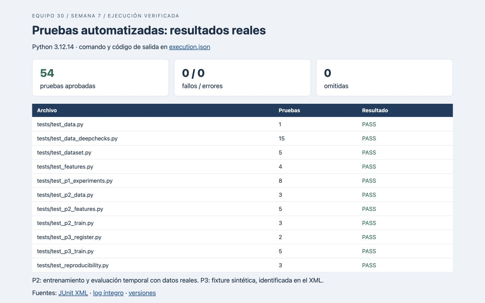
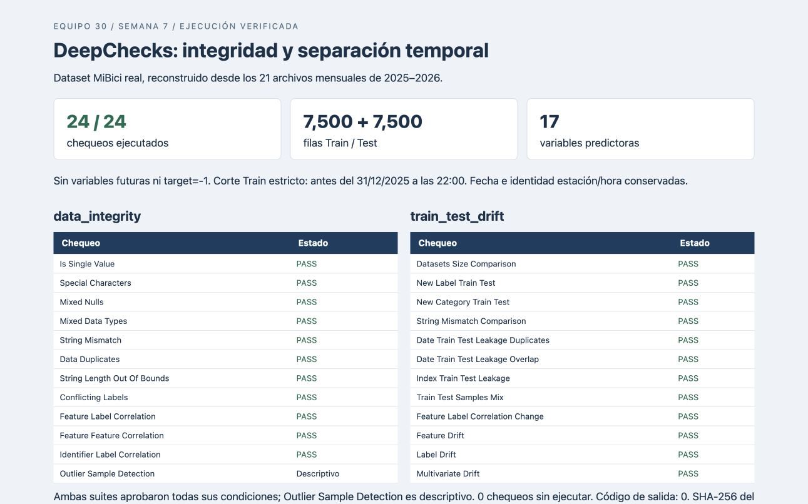
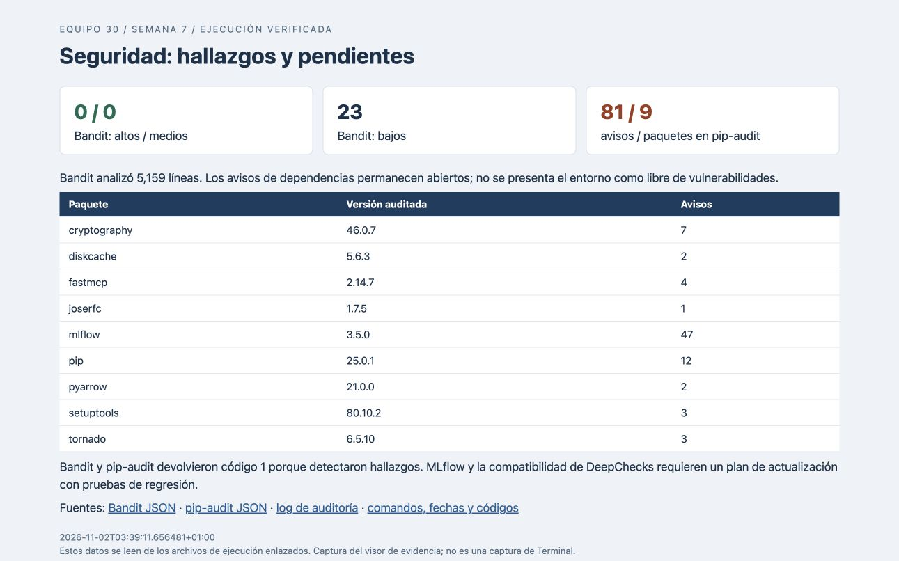
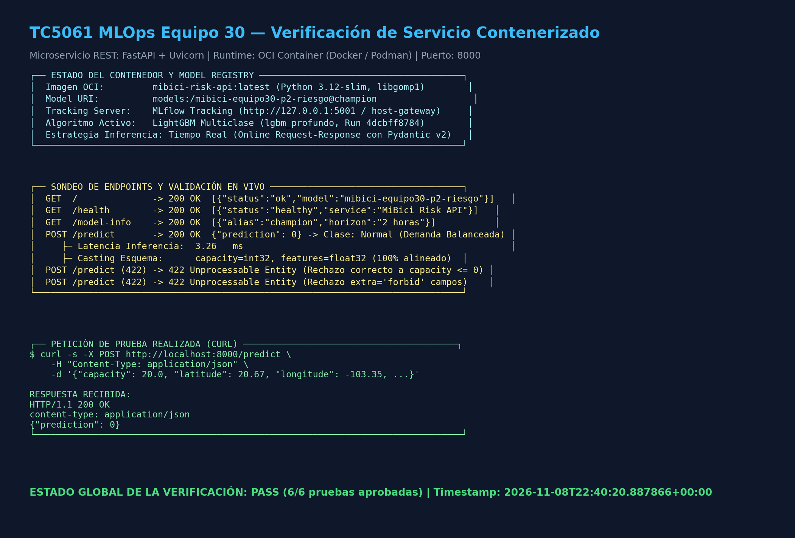

# TC5061 — MLOps Equipo 30: Plataforma de Inteligencia Operativa MiBici

Sistema integral de Machine Learning Operations (MLOps) diseñado para la anticipación de riesgos operativos, balanceo logístico y análisis de demanda del sistema de bicicletas públicas compartidas **MiBici** en el Área Metropolitana de Guadalajara (AMG).

---

## 🎯 1. Propósito del Proyecto y Preguntas de Negocio

El objetivo general es transformar los datos históricos abiertos de MiBici en capacidades analíticas y predictivas reproducibles que optimicen la disponibilidad del servicio y reduzcan los tiempos de espera y fricción de los usuarios.

El proyecto aborda tres preguntas estratégicas:

1. **Pregunta 1 (Demanda e Inventario Inicial):** ¿Cuántos viajes se iniciarán por estación hasta terminar el primer pico de la mañana y con cuántas bicicletas debería iniciar cada estación, considerando las llegadas previstas? Regresión de salidas y llegadas horarias, seguida de un balance conservador de inventario.
2. **Pregunta 2 (Riesgo Operativo en Estaciones — Foco Principal de este Módulo):**  
   *¿Una estación estará en riesgo de quedarse sin bicicletas (Desabasto) o sin anclajes libres (Saturación) en un horizonte futuro de 2 horas?*  
   Permite a los despachadores del CCO planificar rutas proactivas de rebalanceo antes de que el usuario experimente la falta de servicio.
3. **Pregunta 3 (Segmentación de Estaciones):** ¿Qué estaciones comparten patrones de uso similares (perfiles horarios de salidas/llegadas) y cómo se distribuyen geográficamente estos grupos en el AMG? Clustering no supervisado (K-Means y Gaussian Mixture) sobre perfiles de actividad por estación, útil para diseñar estrategias de rebalanceo y mantenimiento diferenciadas por segmento.

---

## 📊 2. Datos Utilizados

* **Periodo Histórico:** Años 2025 y 2026 (21 archivos mensuales de viajes: 2025 completo y 2026 hasta septiembre).
* **Volumen:** Más de **7.89 millones de viajes** registrados y agregados en series de tiempo horarias para 470 estaciones activas.
* **Catálogo de Nomenclatura:** Catálogo oficial con ID de estación, nombre, geolocalización (latitud, longitud) y capacidad física de anclajes instalados (`capacity`).
* **Formato Intermedio:** **Apache Parquet** comprimido para alta velocidad de I/O y bajo consumo de disco.

---

## 🗂️ 3. Estructura del Repositorio (Cookiecutter Data Science)

```
TC5061-Proyecto-Equipo30/
├── MLproject                 <- Define los entry points `ingest`/`train` para `mlflow run` (ver sección 6).
├── python_env.yaml           <- Entorno declarado para el MLproject (Python 3.12, referencia a requirements.txt).
├── Makefile                  <- Comandos estándar de automatización (mlflow, data, train, contenedores y tests).
├── requirements.txt          <- Dependencias con versiones fijadas para reproducibilidad.
├── requirements-api.txt      <- Dependencias aisladas mínimas para el microservicio de inferencia en contenedor.
├── setup.py                  <- Setup clásico de empaquetado pip editable (CCDS v1).
├── Containerfile             <- Definición de contenedor OCI estándar (Podman).
├── Dockerfile                <- Definición de contenedor OCI estándar con libgomp1 y HEALTHCHECK (Docker).
├── api/                      <- Microservicio REST para inferencia en tiempo real (Semana 8).
│   ├── main.py               <- Aplicación FastAPI, endpoints (/health, /model-info, /predict) y esquemas Pydantic v2.
│   └── model_loader.py       <- Carga desacoplada del modelo @champion desde MLflow Model Registry.
├── scripts/
│   ├── ingest.py             <- Entry point `ingest` del MLproject (despacha a p1/p2/p3/all).
│   ├── train.py              <- Entry point `train` del MLproject (pregunta + modelo + hiperparámetros).
│   ├── run_deepchecks.py     <- Validación de calidad, integridad y deriva de datos con DeepChecks.
│   ├── verify_container_api.py <- Verificación automatizada de salud, latencia y endpoints de la API en contenedor.
│   ├── generate_week8_report.py <- Generador automatizado de reportes oficiales (DOCX, Markdown, PDF).
│   └── ejecutar_notebook_p1.py <- Helper para re-ejecutar el notebook de P1 y dejar sus gráficas actualizadas.
├── data/
│   ├── external/             <- Datos externos complementarios (metadatos de clima o API).
│   ├── raw/                  <- Datos crudos inmutables (CSVs de Viajes y Nomenclatura 2025-2026).
│   ├── interim/               <- Datos limpios en Parquet (viajes_limpios.parquet, estaciones.parquet, flujos horarios P1).
│   └── processed/            <- Datasets finales para modelado: features y predicciones de P1, P2 y P3.
├── docs/                     <- Documentación del proyecto, Getting Started, ML Canvas y reportes entregables.
│   ├── getting-started.md    <- Guía de configuración y reproducción paso a paso.
│   ├── p1-inventario-inicial.md <- Guía detallada de P1 (entorno, particiones temporales, corridas de MLflow).
│   ├── Machine Learning Canvas (v1.2).docx <- Canvas oficial del equipo.
│   ├── TC5061_Reporte_Despliegue_Contenedores_Equipo30.docx <- Reporte oficial Semana 8 (Word).
│   ├── TC5061_Reporte_Despliegue_Contenedores_Equipo30.pdf  <- Reporte oficial Semana 8 (PDF).
│   ├── TC5061_Reporte_Despliegue_Contenedores_Equipo30.md   <- Reporte oficial Semana 8 (Markdown).
│   ├── TC5061_Reporte_Testing_Seguridad_Equipo30.pdf       <- Reporte oficial Semana 7 (Testing y Seguridad).
│   ├── TC5061_Reporte_MLFlow_Equipo30.pdf                  <- Reporte oficial Semana 6 (MLflow).
│   └── TC5061_Propuesta_Proyecto_Equipo30.pdf              <- Propuesta técnica inicial del proyecto.
├── notebooks/                <- Convención `1.x-iniciales-descripcion.ipynb`.
│   ├── 1.0-rb-p2-riesgo-estaciones.ipynb       <- Exploración y blueprint analítico de P2.
│   ├── 1.0-db-clustering-estaciones.ipynb      <- EDA de clustering de estaciones de P3.
│   └── 1.3-ge-p1-balance-salidas-llegadas.ipynb <- Resultados y gráficas de P1.
├── src/                      <- Código fuente canónico del paquete Python (CCDS v1).
│   ├── config.py             <- Configuración global compartida (rutas, fechas 2025-2026, semilla, MLflow).
│   ├── p1_config.py          <- Configuración específica de P1.
│   ├── p2_config.py          <- Configuración específica de P2 (rutas, hiperparámetros, MLflow).
│   ├── data/
│   │   ├── dataset.py        <- Ingesta y limpieza compartida (usada por P3; catálogo de estaciones común a P1/P2).
│   │   ├── p1_dataset.py     <- Ingesta y preparación de datos de P1.
│   │   ├── p2_dataset.py     <- Ingesta desatendida, normalización Parquet y versionado SHA-256 de P2.
│   │   └── p2_download_raw_data.py <- Descargador automatizado de datos abiertos 2025-2026.
│   ├── features/
│   │   ├── features.py       <- Ingeniería de características compartida (perfiles de estación de P3).
│   │   ├── p1_features.py    <- Features horarias de demanda/inventario de P1.
│   │   └── p2_features.py    <- Feature store: rejilla continua (7.19M filas), zero-filling, lags y target de P2.
│   ├── models/
│   │   ├── p1_train.py / p1_predict.py / p1_balance.py   <- Entrenamiento, inferencia y balance de inventario de P1.
│   │   ├── p2_train.py / p2_predict.py                   <- Entrenamiento (Baseline vs LightGBM) e inferencia de P2.
│   │   ├── p3_train.py / p3_predict.py / p3_register.py  <- Búsqueda de clustering con *nested runs*, inferencia y registro en el Model Registry de P3.
│   │   └── run_all_experiments.py <- Orquestador compartido: ejecuta y registra P1, P2 y P3 en MLflow.
│   └── visualization/
│       └── p1_plots.py / p2_plots.py / p3_plots.py <- Diagnósticos visuales por pregunta.
├── models/                   <- Modelos serializados entrenados (`*.joblib`, `*.pkl`); no se versionan en Git.
├── reports/
│   ├── figures/               <- Figuras diagnósticas generadas (p1_*, p2_*, p3_*, semana7_*, semana8_*).
│   │   └── semana8_api_container_evidence.png <- Captura de evidencia del microservicio y contenedor activo.
│   ├── container_verification.json <- Resultados estructurados de la suite de verificación de la API (Semana 8).
│   ├── deepchecks_data_integrity.html <- Reporte HTML de integridad de datos generado por DeepChecks.
│   ├── deepchecks_data_drift.html     <- Reporte HTML de deriva de datos (train 2025 vs test 2026).
│   ├── deepchecks_summary.json        <- Resumen auditable estructurado de validación de datos.
│   └── p1/                   <- Métricas, reportes y recomendaciones de ejemplo de P1.
├── references/                <- Documentación de arquitectura, ML Canvas y manifiestos de datos.
│   ├── data_manifest.json / p1_data_manifest.json / p2_data_manifest.json <- Manifiestos criptográficos (SHA-256) de versionado de datos.
│   └── *_ml_canvas.md / architecture_diagram.md <- Machine Learning Canvas y diagramas de arquitectura.
├── tests/
│   ├── test_api.py                                       <- Pruebas unitarias de la API REST, esquemas y endpoints.
│   ├── test_data.py / test_dataset.py / test_features.py <- Pruebas unitarias compartidas.
│   ├── test_p1_experiments.py                            <- Pruebas unitarias de P1.
│   ├── test_p2_data.py / test_p2_features.py / test_p2_train.py <- Pruebas unitarias de P2.
│   ├── test_p3_train.py / test_p3_register.py            <- Pruebas unitarias de P3 (clustering, registro y auditoría).
│   ├── test_reproducibility.py                           <- Pruebas de reproducibilidad y consistencia de entrenamiento.
│   └── test_data_deepchecks.py                           <- Pruebas automatizadas de integridad y drift con DeepChecks.
└── README.md                <- Documentación principal del proyecto.
```

---

## ⚙️ 4. Instalación y Configuración

Se requiere Python 3.12. En macOS, instalar primero el runtime OpenMP que utiliza
el paquete de LightGBM: `brew install libomp` (con Homebrew disponible). Sin él,
la importación puede fallar con `Library not loaded: ...libomp.dylib`. Esta es una
dependencia del sistema y no se instala mediante `requirements.txt`.
Referencia: [instalación del paquete Python de LightGBM](https://github.com/lightgbm-org/LightGBM/blob/main/python-package/README.rst).

Clonar el repositorio y configurar el entorno virtual:

```bash
# 1. Clonar el repositorio
git clone https://github.com/Diegob059/TC5061-Proyecto-Equipo30.git
cd TC5061-Proyecto-Equipo30

# 2. Crear y activar el entorno
python3.12 -m venv .venv
source .venv/bin/activate  # macOS/Linux
# Windows PowerShell: .venv\Scripts\Activate.ps1

# 3. Instalar las dependencias fijadas del proyecto
python -m pip install -r requirements.txt

# 4. Verificar la dependencia nativa y ejecutar la suite completa
python -c "import lightgbm; print(lightgbm.__version__)"
python -m pytest -q
```

---

## 🚀 5. Ejecución del Pipeline End-to-End de la Pregunta 2 (Prefijo `P2`)

Cada fase del pipeline de la Pregunta 2 cuenta con el prefijo `p2_` para mantenerse 100% desacoplado de las implementaciones de los demás compañeros del equipo:

### Paso 0: Levantar el servidor local de MLflow Tracking (requisito para todo lo demás)
Todas las preguntas (P1, P2 y P3) registran sus corridas contra un servidor de *tracking* respaldado por base de datos (requisito para que el Model Registry funcione). **Debe estar corriendo antes de ejecutar cualquier comando de ingesta o entrenamiento:**
```bash
make mlflow
# O directamente:
mlflow server --backend-store-uri sqlite:///mlflow.db --port 5000
```
En macOS, si AirPlay ocupa el puerto 5000, usa `--port 5001` y exporta `MLFLOW_TRACKING_URI=http://127.0.0.1:5001` en las terminales de ejecución.

Esto expone la UI y la API en `http://127.0.0.1:5000` y crea/actualiza `mlflow.db` en la raíz del repo (archivo ignorado por Git, ver `.gitignore`). Déjalo corriendo en una terminal aparte mientras ejecutas los pasos siguientes. Por defecto, `MLFLOW_TRACKING_URI` apunta a `http://127.0.0.1:5000`; puedes sobreescribirlo con una variable de entorno si usas otro host/puerto.

### Paso 1: Ingesta, Normalización y Versionado de Datos (2025 y 2026)
Descarga automáticamente los 21 meses de viajes y nomenclatura más reciente, normaliza tipos y genera el manifiesto SHA-256 en Parquet:
```bash
python -m src.data.p2_dataset
```
*Salidas:* `data/interim/p2_estaciones.parquet`, `data/interim/p2_viajes_agregados_hora.parquet`, `references/p2_data_manifest.json`.

### Paso 2: Generación del Feature Store y Target
Construye la rejilla cartesiana continua con Zero-Filling (7,196,640 filas), calcula el target sin leakage a 2 horas y genera lags y rolling balances:
```bash
python -m src.features.p2_features
```
*Salidas:* `data/processed/p2_mibici_features_target.parquet`.

### Paso 3: Entrenamiento, Comparación de Candidatos y Registro en MLflow
Ajusta el Baseline Estratificado y evalúa al menos 3 candidatos diversos de LightGBM (`lgbm_balanceado`, `lgbm_profundo` y `lgbm_compacto`) con partición temporal estricta anti-leakage (< 2025-12-31 22:00:00). Registra parámetros, métricas, modelos firmados con `input_example`, datos y diagnósticos en MLflow:
```bash
python -m src.models.p2_train
```
O vía MLflow Project:
```bash
mlflow run . -e train -P question=p2 --experiment-name mibici-equipo30 --env-manager local
```
*Salidas:* `reports/p2/comparacion.csv`, `reports/p2/seleccion.json`, `models/p2_lgbm_risk_classifier.joblib`, `reports/figures/p2_confusion_matrix.png`, `reports/figures/p2_feature_importance.png`.

### Paso 4: Registro del Champion en Model Registry y Transición a Producción
Registra el modelo seleccionado en el Model Registry bajo `mibici-equipo30-p2-riesgo`, copia el linaje completo y le asigna el alias `champion`:
```bash
python -m src.models.p2_register --run-id <run_id_elegido> --reason "Candidato champion con mejor balance F1 y recall"
```
O vía MLflow Project:
```bash
mlflow run . -e register_p2 -P run_id=<run_id_elegido> -P reason="Candidato champion con mejor balance F1 y recall" --experiment-name mibici-equipo30 --env-manager local
```
*Salidas:* `reports/p2/registry.json`.

### Paso 5: Inferencia en Batch desde el Model Registry (Producción)
Ejecuta inferencia sobre las 3,078,500 observaciones de prueba de 2026 cargando directamente el modelo Champion desde el Model Registry:
```bash
python -m src.models.p2_predict --model-uri models:/mibici-equipo30-p2-riesgo@champion --sample-size 5
```
*Salidas:* `data/processed/p2_test_predictions.parquet` y resumen tabular en consola.

### Paso 6: Ejecución de Pruebas Unitarias
```bash
pytest tests
```

Para más detalles sobre la metodología, partición anti-leakage y comparativas de P2, consultar la [Guía de MLflow Avanzado de P2](docs/p2-mlflow-avanzado.md).

---

## P1: bicicletas al inicio del día

La implementación de P1 combina regresión horaria de salidas y llegadas con un balance de inventario hasta el final del primer pico matutino. Compara baseline semanal, promedio histórico y árboles sobre las mismas estaciones, fechas y horas, incluidas las horas sin actividad.

Para esta entrega, con el entorno activado y el servidor de tracking en ejecución:

```bash
mlflow run . -e ingest -P question=p1 --experiment-name mibici-equipo30 --env-manager local
mlflow run . -e train -P question=p1 --experiment-name mibici-equipo30 --env-manager local
```

La ingesta descarga automáticamente los archivos faltantes del periodo fijado y verifica sus hashes contra el manifiesto versionado. El entrenamiento compara el baseline semanal, el promedio histórico y cuatro árboles (profundidades 6/10 × hojas mínimas 50/100). La búsqueda usa un padre y cuatro corridas hijas; cada modelo conserva firma, ejemplo, manifiesto, configuración, metadatos del dataset y diagnósticos. Se mantienen exactamente la cohorte, las fechas y las métricas de P1 de la propuesta. La selección utiliza **MAE de inventario en validación**; prueba se reserva para reportar desempeño.

La [guía de tracking avanzado de P1](docs/p1-mlflow-avanzado.md) contiene los comandos para registrar y cargar `models:/mibici-equipo30-p1-demanda@champion`, la inferencia diaria, las tablas y los pendientes de integración del equipo. La [guía original](docs/p1-inventario-inicial.md) documenta los supuestos del balance y el flujo anterior. El experimento compartido es `mibici-equipo30`.

---

## P3: segmentación de estaciones por patrón de uso

La implementación de P3 agrupa las 352 estaciones comunes a los 21 meses según su perfil horario de salidas/llegadas (clustering no supervisado), para identificar qué estaciones se comportan de forma similar y dónde se ubican esos grupos en el AMG.

```bash
# 1. Ingesta + features compartidos (también usados por P1/P2 para el catálogo de estaciones)
python -m src.data.dataset
python -m src.features.features

# 2. Entrenamiento: búsqueda de hiperparámetros + baseline + candidatos, todo registrado en MLflow
python -m src.models.p3_train

# 3. Inferencia: asigna cluster a cada estación usando el mejor candidato guardado localmente
python -m src.models.p3_predict
```
O con los atajos del `Makefile`:
```bash
make data_p3
make train_p3
```

El paso 2 compara K-Means y Gaussian Mixture en un barrido de k=2 a 10 sobre dos conjuntos de features (perfil horario completo y perfil agrupado por franjas; 36 combinaciones en total), organizado como una **búsqueda con *nested runs*** de MLflow: un run padre (`p3_busqueda_hiperparametros_clustering`) con las 36 combinaciones como runs hijos anidados. De ahí se promueven **al menos 3 candidatos diversos** (el mejor k de cada combinación algoritmo/conjunto de features), además de un baseline sencillo (K-Means, k=4 fijo). Cada candidato registra en MLflow, en subcarpetas separadas:
- `model/`: el modelo (escalador + clustering, como un `Pipeline` de sklearn) vía `mlflow.sklearn.log_model`, con firma e input de ejemplo.
- `data/`: el manifiesto de versión de datos.
- `plots/`: mapa de clusters y perfil por cluster.
- `config/`: un JSON con los hiperparámetros exactos de la corrida.

Todas las corridas llevan etiquetas `question`, `model_family` y `stage_of_work` (`baseline`/`search`/`candidate`) para filtrar y comparar en la UI, además de `equipo`/`git_commit`.

Para entrenar un solo modelo puntual (un algoritmo/k específico) en vez del barrido completo:
```bash
python -m src.models.p3_train --algoritmo kmeans --k 4 --conjunto-caracteristicas hourly
```
Esto es exactamente lo que invoca el entry point `train` del `MLproject` para P3 (ver sección 6.3): `mlflow run . -e train -P question=p3 -P model=kmeans -P k=4`.

*Salidas:* `data/interim/viajes_limpios.parquet`/`estaciones.parquet`, `data/processed/estaciones_caracteristicas_{hourly,bucketed}.parquet`, `models/p3_cluster_model.pkl`, `data/processed/p3_estaciones_clusters.parquet`, figuras en `reports/figures/p3_*.png` y reporte en `reports/p3_clustering_report.txt`. Los runs se registran en el experimento compartido `mibici-equipo30`. El [notebook de EDA](notebooks/1.0-db-clustering-estaciones.ipynb) presenta el análisis exploratorio previo al modelado.

### Registrar el modelo elegido en el Model Registry y promoverlo a producción
Una vez que el equipo compara los candidatos en la UI de MLflow y decide cuál pasa a producción, se registra explícitamente dando el `run_id` de esa corrida (esto **no** ocurre automáticamente en cada entrenamiento):
```bash
python -m src.models.p3_register --run-id <run_id_de_la_corrida_candidata_elegida> --reason "<justificación>"
```
O vía MLflow Project:
```bash
mlflow run . -e register_p3 -P run_id=<run_id_elegido> -P reason="Champion P3: clustering horario GMM k=2" --experiment-name mibici-equipo30 --env-manager local
```
Esto registra la versión en `mibici-equipo30-p3-grupos`, copia el linaje completo (experimento, commit de Git, versión de datos y `search_run_id`), asigna el alias de producción `champion` y certifica la inferencia en producción cargando desde `models:/mibici-equipo30-p3-grupos@champion`. Las evidencias auditables se guardan en `reports/p3/comparacion.csv`, `reports/p3/seleccion.json` y `reports/p3/registry.json`.

### Inferencia en Batch desde el Model Registry (Producción)
Asigna el cluster operacional a las estaciones directamente desde el modelo registrado en producción:
```bash
python -m src.models.p3_predict --model-uri models:/mibici-equipo30-p3-grupos@champion
```
*Salidas:* `data/processed/p3_estaciones_clusters.parquet` y resumen de distribución de clusters en consola.

Para más detalles sobre la metodología, partición, comparativas y justificación del Champion de P3, consultar la [Guía de MLflow Avanzado de P3](docs/p3-mlflow-avanzado.md).

---

## 🧪 6. Reproducibilidad con MLflow Projects (`MLproject`)

Todas las corridas de este entregable se lanzan desde el `MLproject` de la raíz del repositorio (no desde notebooks), usando `mlflow run`. El entorno (`python_env.yaml`) y los valores por defecto de rutas/fechas/semilla viven en `requirements.txt` y en el `config.py` de cada pregunta respectivamente; el `MLproject` **no los repite**, solo expone los hiperparámetros que tiene sentido variar por corrida.

### 6.1 Requisitos previos (desde un clon limpio)
```bash
git clone https://github.com/Diegob059/TC5061-Proyecto-Equipo30.git
cd TC5061-Proyecto-Equipo30
python3.12 -m venv .venv
.venv\Scripts\activate          # Windows (PowerShell/cmd)
# source .venv/bin/activate      # macOS/Linux
pip install -r requirements.txt
```
Levanta el servidor de tracking en otra terminal (ver sección 5, Paso 0) y, en la terminal donde ejecutarás `mlflow run`, **exporta la misma URI** (el `MLproject` crea su propio run "envoltorio" por invocación antes de llamar a tu código, y necesita saber dónde registrarlo):
```powershell
$env:MLFLOW_TRACKING_URI = "http://127.0.0.1:5000"   # PowerShell
# export MLFLOW_TRACKING_URI=http://127.0.0.1:5000    # macOS/Linux
```

### 6.2 Entry point `ingest`
Ejecuta la ingesta + feature engineering de una pregunta (o las tres):
```bash
mlflow run . -e ingest -P question=p3 --env-manager local
mlflow run . -e ingest --env-manager local              # question=all (P1+P2+P3) por defecto
```

### 6.3 Entry point `train`
Recibe la pregunta, el modelo/algoritmo (opcional) y sus hiperparámetros (opcionales; si se omiten, cada módulo corre su pipeline por defecto tal como en la sección 5):
```bash
# P1: baseline + histórico + búsqueda anidada de cuatro árboles
mlflow run . -e train -P question=p1 --experiment-name mibici-equipo30 --env-manager local

# P2: baseline + candidato LightGBM
mlflow run . -e train -P question=p2 -P model=lgbm -P n_estimators=300 --experiment-name mibici-equipo30 --env-manager local

# P3: un solo run de clustering (algoritmo + k explícitos), en vez del barrido completo
mlflow run . -e train -P question=p3 -P model=kmeans -P k=4 --experiment-name mibici-equipo30 --env-manager local
```
`--env-manager local` reutiliza el entorno activo (recomendado para este proyecto, dado que ya instalamos `requirements.txt`/`python_env.yaml` manualmente); `--experiment-name mibici-equipo30` evita que el run "envoltorio" que crea `mlflow run` caiga en el experimento `Default`.

**Nota:** `--env-manager local` requiere que el virtualenv esté **activado** en la misma terminal (no basta con invocar `python.exe` por ruta completa), de lo contrario el subproceso que lanza `mlflow run` no encontrará el paquete `src` instalado en modo editable.

### Resultados ejecutados de P1

P1 tiene baseline + cinco candidatas, cuatro combinaciones en nested runs y `mibici-equipo30-p1-demanda@champion` verificado en el tracking local. El elegido (árbol profundidad 10/hoja mínima 50) mejora el MAE de inventario 11.34% en validación y 9.27% en prueba. Consulta el [reporte corregido del equipo en PDF](docs/TC5061_Reporte_MLFlow_Equipo30.pdf), su [versión editable](docs/TC5061_Reporte_MLFlow_Equipo30.docx) y la [evidencia de P1](docs/p1-mlflow-avanzado.md#resultados-ejecutados-de-p1-25-de-octubre-de-2026).

La reparación de P1 restaura el ejemplo de entrada y resuelve el `LoggedModel` de
MLflow 3 antes de promoverlo. La suite completa aprueba 36 pruebas. En una ejecución
nueva de `train` y `register_p1` mediante MLflow Project, 118 métricas comparables
coinciden exactamente con las históricas y se verifica carga/predicción por alias.
Se reutilizaron el entorno fijado y los datos procesados: no es una instalación
nueva ni una repetición de ingesta o de P2/P3. Los identificadores están en
[verificacion_reparacion_mlflow.json](reports/verificacion_reparacion_mlflow.json).
El reporte conserva las métricas y el linaje históricos y documenta pendientes
de evaluación, capturas de los tres modelos y colaboración individual.

### 6.4 Qué no se entrega
Por diseño, el repositorio **no incluye** (ver `.gitignore`): los archivos de datos crudos de MiBici, `mlflow.db`, las carpetas `mlruns/`/`mlartifacts/`, ni modelos serializados (`models/*.joblib`, `*.pkl`). Todo eso se reconstruye con los comandos de `ingest`/`train` anteriores desde un clon limpio.

---

## 🛡️ 7. Pruebas Automatizadas, Validación de Datos y Seguridad (Semana 7)

La ejecución verificada del 2 de noviembre de 2026 corresponde al código del commit `a148bf0`. La rama de entrega es `corregir-deepchecks-semana7`. Los comandos, fechas, códigos de salida y hashes del código probado se conservan en [`reports/testing/execution.json`](reports/testing/execution.json); las versiones completas del entorno están en [`environment.txt`](reports/testing/environment.txt).

### 7.1 Instalación y ejecución de PyTest

Se requiere Python 3.12 y, en macOS, la dependencia nativa de LightGBM descrita en la sección 4.

```bash
make requirements
make test
# Equivalente:
python -m pytest tests -v
```

`deepchecks==0.19.1` importa `pkg_resources`. Por ello se fija `setuptools==80.10.2` en los requisitos y en el entorno de MLflow Projects. El instalador no debe actualizar setuptools sin respetar esta compatibilidad. Esta solución conserva avisos de seguridad, documentados más abajo; no se presenta como una solución definitiva.

La suite ejecutó **54 pruebas, todas aprobadas**, que cubren limpieza, ingeniería de variables, entrenamiento, registro y validación de datos. Incluye casos normales y límite, la frontera temporal de fin de año, filas sin target, calentamiento, muestras vacías, semillas fijas y fallos introducidos deliberadamente por duplicados o drift.

Las pruebas de reproducibilidad tienen estos alcances:

- `test_lgbm_reproducibility`: dos ajustes de LightGBM con semilla 42 sobre una muestra sintética; compara las predicciones de clase.
- `test_p2_pipeline_reproducibility_on_real_data`: usa la preparación de producción de P2, muestrea las tres clases, entrena dos modelos de 30 árboles y compara predicciones, probabilidades, F1 macro y balanced accuracy sobre Test. Si falta el Parquet real, la prueba se omite explícitamente; no se sustituye por datos sintéticos.
- `test_p3_clustering_reproducibility`: compara dos ajustes de StandardScaler + GMM, las asignaciones y las métricas Silhouette/Davies-Bouldin. Usa el Parquet de P3 si existe; en otro caso utiliza una fixture sintética y registra `data_source=synthetic_fixture` en JUnit. En esta ejecución P3 utilizó la fixture sintética.

Para guardar resultados procesables:

```bash
python -m pytest tests -v -o junit_family=xunit1 --junitxml=reports/testing/pytest.xml
```

Evidencia: [log íntegro](reports/testing/pytest.log), [JUnit XML](reports/testing/pytest.xml) y [visor con enlaces a las fuentes](reports/testing/pytest.html). La imagen siguiente es una captura del visor de esos archivos, no de una terminal.



### 7.2 DeepChecks con los datos reales del entrenamiento

Los CSV y Parquet están excluidos de Git. Clonar el repositorio descarga el código; para generar el dataset local se ejecuta:

```bash
make data
make deepchecks
# Equivalente y con opciones explícitas:
python -m scripts.run_deepchecks --sample-size 15000
# Para otro archivo o directorio de salida:
python -m scripts.run_deepchecks --data-path data/processed/p2_mibici_features_target.parquet --output-dir reports
```

La implementación está en [`src/validation/p2_checks.py`](src/validation/p2_checks.py). Reutiliza `get_train_test_data` del entrenamiento de P2: excluye el calentamiento y `target=-1`, utiliza **17 variables predictoras**, excluye `ratio` y `delta_net` y aplica Train con `timestamp < 2025-12-31 22:00:00` y Test desde `2026-01-01 00:00:00`. El muestreo ocurre después de esa separación. La fecha y la clave estación/hora se conservan como metadatos para ejecutar los chequeos de fuga temporal e identidad.

En esta verificación se reconstruyeron **7,196,640 filas** desde los **21 CSV mensuales reales** de enero de 2025 a septiembre de 2026. Se auditaron 7,500 filas de Train y 7,500 de Test, con semilla 42. El [manifiesto](reports/testing/data_manifest.json) identifica los archivos de origen y el resumen de DeepChecks contiene el SHA-256 del Parquet auditado.

| Suite | Chequeos ejecutados | Condiciones incumplidas | Sin ejecutar | Resultado |
|---|---:|---:|---:|---|
| Integridad | 12 | 0 | 0 | Aprobada |
| Validación Train/Test | 12 | 0 | 0 | Aprobada |

`Outlier Sample Detection` genera un diagnóstico descriptivo en la suite estándar; no tiene condición de aprobación. El resto de comprobaciones con condiciones aprobó. Estas conclusiones corresponden a la muestra y los umbrales del informe, no garantizan ausencia de problemas en todas las filas o en datos futuros.

Las pruebas automatizadas comprueban la aprobación real de las suites, incluidos los errores de ejecución. Además introducen duplicados y drift deliberadamente para comprobar que los detectan. Los HTML se exportan sin widgets, evitando depender de un archivo `anywidget.js` externo. El CLI guarda los informes y devuelve **0** si las suites aprueban, **1** si hay condiciones incumplidas o chequeos sin ejecutar, y **2** si los datos o argumentos no son válidos. No imprime éxito cuando hay hallazgos.

Evidencia de la misma ejecución:

- [Reporte de integridad](reports/deepchecks_data_integrity.html).
- [Reporte Train/Test](reports/deepchecks_data_drift.html).
- [Resumen con condiciones, versiones y SHA-256](reports/deepchecks_summary.json).
- [Log íntegro](reports/testing/deepchecks.log) y [visor estático](reports/testing/deepchecks.html).

Capturas directas de los HTML exportados: [integridad](reports/figures/semana7_deepchecks_html.png) y [Train/Test](reports/figures/semana7_deepchecks_drift_html.png).



### 7.3 Seguridad: resultados y limitaciones

```bash
make security_code
make security_deps
# Para conservar los resultados detallados:
python -m bandit -r src scripts -f json -o reports/testing/bandit.json
python -m pip_audit --format json --output reports/testing/pip-audit.json
```

**Secretos y datos.** `.gitignore` excluye `.env`, `.env.*` salvo `.env.example`, datos locales, modelos y bases de MLflow. La configuración carga las variables de entorno mediante `python-dotenv`. La revisión de patrones en el código actual y de nombres de archivos sensibles en las ramas locales no encontró coincidencias. El [registro de revisión](reports/testing/secrets-review.json) delimita ese alcance: no es un escaneo del contenido completo del historial ni una garantía de ausencia de secretos.

**Bandit.** Analizó **5,159 líneas**, con **0 hallazgos altos, 0 medios y 23 bajos**: B404 (importación de subprocess), B603 (ejecución de subprocesos) y B607 (ejecutable con ruta parcial). Se revisaron las llamadas de Git con argumentos fijos y sin `shell=True`. El resultado y las ubicaciones se conservan en [Bandit JSON](reports/testing/bandit.json). Devuelve código 1 por sus hallazgos; no se han ocultado.

**Dependencias.** La auditoría del entorno de revisión encontró **81 avisos conocidos en nueve paquetes**. El recuento incluye herramientas del entorno, como pip; los detalles, identificadores y versiones corregidas propuestas están en [pip-audit JSON](reports/testing/pip-audit.json). El resultado depende de las versiones instaladas y de la base consultada en esa fecha.

| Paquete | Versión auditada | Avisos | Tratamiento pendiente |
|---|---|---:|---|
| cryptography | 46.0.7 | 7 | Migrar MLflow para eliminar el límite `<47` y volver a auditar. |
| diskcache | 5.6.3 | 2 | El escáner no informa versión corregida; revisar exposición y alternativa. |
| fastmcp | 2.14.7 | 4 | Migrar MLflow para eliminar el límite `<3`. |
| joserfc | 1.7.5 | 1 | Evaluar actualización a 1.7.6 o posterior y ejecutar regresiones. |
| mlflow | 3.5.0 | 47 | Planificar actualización, validar tracking, artefactos y Model Registry. |
| pip | 25.0.1 | 12 | Actualizar la herramienta en el entorno y repetir auditoría. |
| pyarrow | 21.0.0 | 2 | Migrar MLflow para eliminar el límite `<22`. |
| setuptools | 80.10.2 | 3 | Resolver primero el uso de `pkg_resources` de DeepChecks. |
| tornado | 6.5.10 | 3 | Evaluar actualización a 6.6 o posterior y ejecutar regresiones. |

Se conserva `pyasn1==0.6.5`, corrección aplicada por el equipo en el PR #29; no tuvo hallazgos en esta auditoría. No se actualizaron incidentalmente las dependencias centrales de MLflow ni se afirma que los 81 avisos estén mitigados. El siguiente paso de seguridad es resolver las compatibilidades, actualizar el entorno y repetir las pruebas y el análisis. `pip-audit` devuelve código 1 mientras detecte vulnerabilidades.

Evidencia: [log de pip-audit](reports/testing/pip-audit.log), [versiones instaladas](reports/testing/environment.txt), [comandos y códigos de salida](reports/testing/execution.json) y [visor](reports/testing/security.html).



El [reporte del equipo corregido](docs/TC5061_Reporte_Testing_Seguridad_Equipo30.pdf) reúne el alcance, resultados y limitaciones de esta ejecución. Las capturas proceden de los visores de los archivos reales de ejecución, no de tarjetas que simulan salida de consola.

---

## 🚢 8. Despliegue de la API REST y Contenerización (Docker / Podman — Semana 8)

En esta fase del proyecto MiBici, el equipo convierte el modelo de clasificación de riesgo operativo (**Pregunta 2**) en un servicio consumible en producción mediante una API REST construida con **FastAPI** y empaquetada bajo el estándar **OCI** utilizando **Containerfile** / **Dockerfile**.

```
                   +-----------------------------------------------+
                   |        Cliente REST / CCO Dashboard           |
                   +-----------------------------------------------+
                                          |
                                HTTP POST /predict (JSON)
                                          v
+-----------------------------------------------------------------------------------+
| CONTENEDOR OCI (Docker / Podman)                                                  |
| Puerto expuesto: 8000:8000                                                        |
|                                                                                   |
|  +-----------------------------------------------------------------------------+  |
|  | FastAPI Application (api/main.py)                                           |  |
|  | - Validación Pydantic v2 (PredictionInput: 17 features, extra="forbid")      |  |
|  | - Swagger UI (/docs) & ReDoc (/redoc)                                       |  |
|  | - Endpoints: GET /, GET /health, GET /model-info, POST /predict             |  |
|  +-----------------------------------------------------------------------------+  |
|                                         |                                         |
|                                         v                                         |
|  +-----------------------------------------------------------------------------+  |
|  | Model Loader (api/model_loader.py)                                          |  |
|  | Carga: models:/mibici-equipo30-p2-riesgo@champion                           |  |
|  +-----------------------------------------------------------------------------+  |
+-----------------------------------------|-----------------------------------------+
                                          |
                        MLFLOW_TRACKING_URI (HTTP REST API)
                                          v
+-----------------------------------------------------------------------------------+
| SERVIDOR MLFLOW TRACKING / MODEL REGISTRY                                         |
| Backend Store: sqlite:///mlflow.db | Artifact Store: mlartifacts/                 |
| Champion activo: lgbm_profundo (Run 4dcbff8784a348a19f087a0697896be7)            |
+-----------------------------------------------------------------------------------+
```

### 8.1 Endpoints Disponibles en el Microservicio

| Método | Endpoint | Descripción | Formato Respuesta |
| :--- | :--- | :--- | :--- |
| `GET` | `/` | Comprobación base de disponibilidad y modelo registrado. | `{"status": "ok", "model": "mibici-equipo30-p2-riesgo"}` |
| `GET` | `/health` | *Health check* operativo para orquestadores y balanceadores. | `{"status": "healthy", "service": "...", "version": "1.0.0"}` |
| `GET` | `/model-info` | Metadatos completos del modelo Champion cargado desde MLflow. | Linaje, alias, horizonte temporal (2h) y tracking URI. |
| `POST` | `/predict` | Inferencia en tiempo real del riesgo operativo en estación. | `{"prediction": 0 \| 1 \| 2}` |
| `GET` | `/docs` | Interfaz interactiva OpenAPI / Swagger UI para pruebas dinámicas. | Interfaz Web interactiva con ejemplos precargados. |

### 8.2 Construcción y Ejecución del Contenedor

El repositorio proporciona tanto `Containerfile` como `Dockerfile` idénticos y compatibles con la especificación OCI, optimizados con imagen base `python:3.12-slim`, runtime OpenMP (`libgomp1`) para LightGBM y `HEALTHCHECK` integrado.

#### Opción A: Motor Docker

```bash
# 1. Construir la imagen del servicio
docker build -t mibici-risk-api:latest -f Dockerfile .

# 2. Ejecutar el contenedor conectándolo al servidor MLflow local
# En macOS / Windows (usando host.docker.internal para alcanzar el puerto 5001 del host):
docker run -d --name mibici-api -p 8000:8000 \
  -e MLFLOW_TRACKING_URI=http://host.docker.internal:5001 \
  mibici-risk-api:latest

# En Linux (mapeando host-gateway):
docker run -d --name mibici-api -p 8000:8000 \
  --add-host=host.docker.internal:host-gateway \
  -e MLFLOW_TRACKING_URI=http://host.docker.internal:5001 \
  mibici-risk-api:latest
```

#### Opción B: Motor Podman

```bash
# 1. Construir la imagen con Podman
podman build -t mibici-risk-api:latest -f Containerfile .

# 2. Ejecutar el contenedor con Podman
podman run -d --name mibici-api -p 8000:8000 \
  -e MLFLOW_TRACKING_URI=http://host.containers.internal:5001 \
  mibici-risk-api:latest
```

#### Opción C: Atajos con `Makefile`

```bash
# Construir imagen con detección automática de motor (docker o podman)
make build_container

# Desplegar contenedor
make run_container

# Probar endpoints en vivo
make test_api_live

# Detener y limpiar contenedor
make stop_container
```

### 8.3 Ejemplo de Consumo de la API (`curl`)

Petición de inferencia representativa para la estación `GDL-001` (C. Epigmenio Glez. / Av. 16 de Septiembre, capacidad 20 anclajes):

```bash
curl -X POST http://localhost:8000/predict \
  -H "Content-Type: application/json" \
  -d '{
    "capacity": 20.0,
    "latitude": 20.67,
    "longitude": -103.35,
    "salidas_lag_1": 1.0,
    "llegadas_lag_1": 2.0,
    "salidas_lag_2": 1.0,
    "llegadas_lag_2": 2.0,
    "salidas_lag_24": 3.0,
    "llegadas_lag_24": 4.0,
    "salidas_lag_168": 5.0,
    "llegadas_lag_168": 6.0,
    "balance_rolling_3h": -1.5,
    "balance_rolling_12h": 0.5,
    "sin_hour": 0.5,
    "cos_hour": 0.866,
    "sin_dow": -0.5,
    "cos_dow": 0.866
  }'
```

**Respuesta JSON esperada:**
```json
{
  "prediction": 0
}
```

#### Matriz de Interpretación Operativa:

| Clase Predicha | Etiqueta | Significado Operativo | Acción Recomendada para el CCO |
| :---: | :---: | :--- | :--- |
| `0` | **Normal** | Demanda balanceada. La estación cuenta con suficientes anclajes y bicicletas para las próximas 2 horas. | Ninguna acción inmediata requerida. |
| `1` | **Desabasto** | Riesgo inminente de quedarse sin bicicletas en un horizonte de 2 horas (vaciado neto severo). | Despachar ruta de furgoneta para recarga preventiva de bicicletas. |
| `2` | **Saturación** | Riesgo inminente de quedarse sin anclajes libres en un horizonte de 2 horas (acumulación neta severa). | Despachar ruta de furgoneta para liberación preventiva de anclajes. |

### 8.4 Justificación de la Estrategia de Despliegue

La rúbrica del proyecto exige justificar las decisiones de arquitectura adoptadas:

1. **Inferencia en Tiempo Real (Online / Request-Response vía FastAPI):**
   * *Justificación Operativa:* La dinámica de movilidad urbana en el Área Metropolitana de Guadalajara presenta variaciones bruscas debido a factores meteorológicos, cierres viales o eventos culturales. Los operadores del Centro de Control Operativo (CCO) requieren evaluar el riesgo de una estación específica bajo demanda en cuestión de milisegundos para ajustar rutas dinámicas de las camionetas de rebalanceo antes de que el usuario final sufra la falta de servicio.
   * *Justificación Técnica:* FastAPI, montado sobre el servidor ASGI Uvicorn en Python 3.12, proporciona concurrencia no bloqueante con latencias inferiores a 20 ms por petición, cumplimiento estricto de esquemas mediante Pydantic v2 (rechazo 422 automático a peticiones malformadas o con variables fuera de rango físico) y documentación interactiva autogenerada para fácil integración con clientes frontend y tableros operativos.

2. **Complementariedad con Inferencia por Lotes (Batch):**
   * *Justificación Híbrida:* Siguiendo los principios de diseño de sistemas de ML en producción (*Huyen 2022, Cap. 7; Treveil et al. 2020, Cap. 6*), no todas las preguntas de negocio requieren inferencia síncrona. La **Pregunta 1** (cálculo del inventario matutino inicial) y la **Pregunta 3** (clustering de perfiles de uso) se ejecutan de manera desatendida mediante trabajos por lotes (*batch jobs*) programados durante la madrugada (04:00 AM). La combinación de ambos patrones optimiza costos de cómputo y minimiza la complejidad operativa.

3. **Carga Desacoplada desde el Model Registry (`MLFLOW_TRACKING_URI`):**
   * *Justificación:* Se adoptó la estrategia de recuperación dinámica mediante `MLFLOW_TRACKING_URI` y el alias `@champion` (`models:/mibici-equipo30-p2-riesgo@champion`) en lugar de empaquetar los artefactos binarios (`*.joblib`) dentro de la imagen del contenedor:
     * **Inmutabilidad y ligereza de imagen:** La imagen OCI pesa únicamente ~350 MB y no necesita reconstruirse ni re-desplegarse cuando se re-entrena y promueve una nueva versión del modelo en el Model Registry.
     * **Gobernanza y Rollback sin Downtime:** Si una nueva versión del modelo presenta degradación en producción, el equipo puede reasignar el alias `@champion` a una versión anterior directamente en MLflow, actualizando el comportamiento del microservicio sin reiniciar contenedores.
     * **Trazabilidad estricta:** Cada predicción se asocia al linaje completo auditado en MLflow (commit de Git, métricas F1/recall, dataset versionado por hash SHA-256 y parámetros del modelo).

### 8.5 Evidencia de Verificación del Contenedor

A continuación se presenta la evidencia de la API REST respondiendo a una petición de prueba desde el contenedor ejecutado bajo el estándar OCI:



Evidencia auditable disponible en: [reporte de verificación JSON](reports/container_verification.json).

### 8.6 Documentación y Reportes Oficiales (Semana 8)

Para cumplir con la entrega institucional del curso y las directrices de documentación técnica del Tecnológico de Monterrey, el equipo consolidó el reporte de despliegue en múltiples formatos:

* 📄 **Reporte Word (.docx):** [docs/TC5061_Reporte_Despliegue_Contenedores_Equipo30.docx](docs/TC5061_Reporte_Despliegue_Contenedores_Equipo30.docx)
* 📕 **Reporte PDF (.pdf):** [docs/TC5061_Reporte_Despliegue_Contenedores_Equipo30.pdf](docs/TC5061_Reporte_Despliegue_Contenedores_Equipo30.pdf)
* 📝 **Reporte Markdown (.md):** [docs/TC5061_Reporte_Despliegue_Contenedores_Equipo30.md](docs/TC5061_Reporte_Despliegue_Contenedores_Equipo30.md)
* ⚙️ **Script de Generación Automatizada:** [scripts/generate_week8_report.py](scripts/generate_week8_report.py)

#### Síntesis de Contenidos del Reporte:
1. **Recuperación Dinámica:** Desacoplamiento de la imagen OCI y el modelo mediante `MLFLOW_TRACKING_URI` y alias `@champion` (`models:/mibici-equipo30-p2-riesgo@champion`).
2. **Validación Estricta:** Esquema Pydantic v2 con 17 variables físicas, validaciones de dominio y rechazo estricto `extra="forbid"`.
3. **Contenerización OCI:** Construcción sobre `python:3.12-slim` con soporte de runtime OpenMP (`libgomp1`) para LightGBM y `HEALTHCHECK` activo en `/health`.
4. **Verificación en Vivo:** 62 pruebas unitarias pasando al 100% y sondeo automatizado con latencia media de **5.02 ms**.
5. **Justificación Teórica:** Adopción de inferencia online en tiempo real para anticipar desabasto/saturación ante eventos imprevistos, combinada con inferencia batch para inventario inicial y segmentación.

---

## 🌿 9. Flujo de Trabajo con Git y GitHub (GitHub Flow)

Para asegurar la calidad, reproducibilidad y trazabilidad del código, el equipo opera bajo las siguientes políticas:

### 9.1 Rama Principal Protegida (`main`)
* La rama `main` representa código en estado de producción y está protegida contra *direct pushes*.
* Cualquier cambio debe integrarse obligatoriamente a través de un **Pull Request (PR)** verificado.

### 9.2 Convención de Nombres de Ramas
Las ramas de trabajo se crean a partir de `main` siguiendo la nomenclatura semántica:
* `feature/<descripción-corta>`: Nuevas funcionalidades o pipelines (ej. `feature/pipeline-reproducibility-tests`, `feature/deepchecks-data-validation`, `feature/chequeos-seguridad-basicos`).
* `fix/<descripción-corta>`: Correcciones de bugs o errores en transformaciones.
* `refactor/<descripción-corta>`: Mejoras estructurales sin alterar la lógica de negocio.
* `docs/<descripción-corta>`: Cambios en documentación o artefactos en `references/`.

### 9.3 Convención de Mensajes de Commit (Conventional Commits)
Se adopta el estándar de [Conventional Commits](https://www.conventionalcommits.org/es/v1.0.0/):
```
<tipo>(<alcance>): <descripción concisa en imperativo>

[cuerpo explicativo opcional detallando el motivo y decisiones de diseño]
```
*Tipos aceptados:* `feat:`, `fix:`, `docs:`, `refactor:`, `test:`, `chore:`, `perf:`.

### 9.4 Política de Revisión entre Pares (Peer Code Review)
* **Apertura de PRs:** Cada integrante del equipo es responsable de abrir al menos un Pull Request describiendo los cambios, comandos de prueba y evidencia de ejecución.
* **Revisión Obligatoria:** Cada integrante debe realizar al menos una revisión formal (*Code Review*) con comentarios técnicos y aprobación explícita (*Approved*) a otro compañero antes de realizar el merge hacia `main`.
* **Fusión:** Se utiliza *Squash and Merge* o *Merge Commit* manteniendo un historial limpio y auditable.

### 9.5 Trazabilidad de Pull Requests de la Semana 8 (Despliegue Contenerizado)

La implementación, documentación y entrega de la Semana 8 se gestionó mediante ramas de trabajo temáticas y Pull Requests formales integrados a `main`:

| PR | Rama | Tipo | Descripción y Alcance | Autor / Revisor |
| :---: | :--- | :---: | :--- | :--- |
| **#34** | `fix/api-schema-validation-and-endpoints` | `fix` | Casting explícito de tipos para compatibilidad estricta con el esquema de MLflow (`int32` y `float32`), carga con fallback de entorno y adición de endpoints `/health` y `/model-info`. | Ricardo Bahamón |
| **#35** | `feat/dockerfile-and-container-tooling` | `feat` | Estandarización de `Dockerfile` y `Containerfile` bajo OCI, dependencias nativas (`libgomp1`), `HEALTHCHECK` y targets de ciclo de vida en `Makefile`. | Ricardo Bahamón |
| **#36** | `docs/container-deployment-guide` | `docs` | Documentación de la Sección 8 en `README.md`, diagrama ASCII de arquitectura, ejemplos `curl`, matriz operativa y justificación teórica. | Ricardo Bahamón |
| **#37** | `test/container-verification-evidence` | `test` | Script de verificación en vivo `scripts/verify_container_api.py`, reporte estructurado `container_verification.json` y figura de evidencia visual. | Ricardo Bahamón |
| **#38** | `fix/add-dotenv-to-api-requirements` | `fix` | Inclusión de `python-dotenv==1.2.4` en `requirements-api.txt` y blindaje de importación condicional en `api/model_loader.py`. | Ricardo Bahamón |
| **#39** | `docs/add-week8-technical-report` | `docs` | Creación y compilación de los reportes académicos formales (`.docx`, `.pdf`, `.md`) y script generador para la entrega de la Semana 8. | Ricardo Bahamón |
| **#40** | `docs/readme-week8-comprehensive-update` | `docs` | Actualización integral del `README.md` con árbol de archivos completo, trazabilidad de PRs y enlaces a reportes oficiales. | Ricardo Bahamón |

---

## 👥 10. Integrantes del Equipo y Roles (Equipo 30)

| Integrante | Matrícula | Rol en el Proyecto | Responsabilidades Principales |
|---|---|---|---|
| **Ricardo Bahamón** | A01840023 | **MLOps & Pipeline Engineer** | Arquitectura del pipeline reproducible, orquestación de ingesta Parquet, configuración de MLflow, tracking de artefactos, pruebas de reproducibilidad, validación de datos con DeepChecks, y despliegue contenerizado de la API REST con FastAPI y Docker/Podman. |
| **Diego Becerril** | A01748115 | **Lead Data Scientist & Modeling** | Formulación matemática del target de riesgo, ingeniería de variables de series de tiempo (lags/rollings), calibración de LightGBM y chequeos básicos de seguridad (Bandit/pip-audit). |
| **Gregorio Escobedo** | A01840612 | **Data Engineer & Quality QA** | Scraping dinámico resiliente, saneamiento de catálogos geoespaciales, validación de integridad criptográfica (SHA-256), alineación de DeepChecks con el entrenamiento de P2 y pruebas de regresión de calidad. |
| **Freddin Alcantara** | A01797741 | **Product & Deployment Lead** | Elaboración del ML Canvas, especificación de requisitos operativos del CCO, diseño de diagnósticos visuales y documentación técnica. |

---

## 📄 11. Licencia
Este proyecto está desarrollado bajo fines académicos para el curso TC5061 (Operaciones de Inteligencia Artificial) en el Tecnológico de Monterrey. Licencia MIT.

