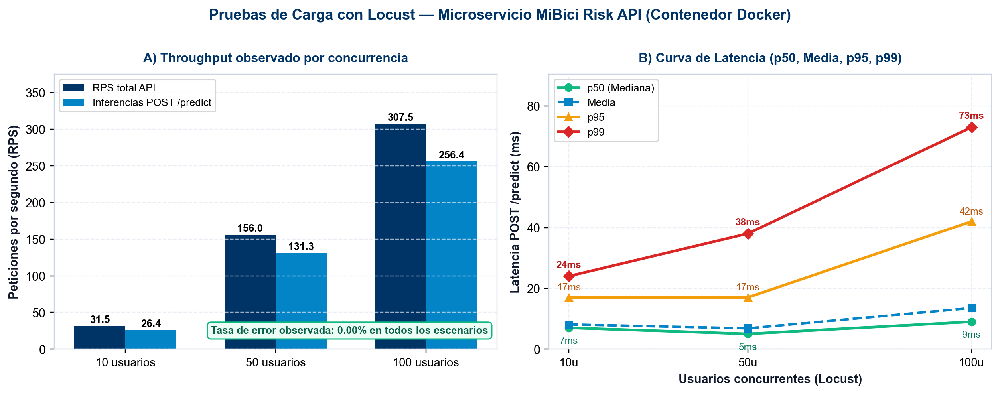
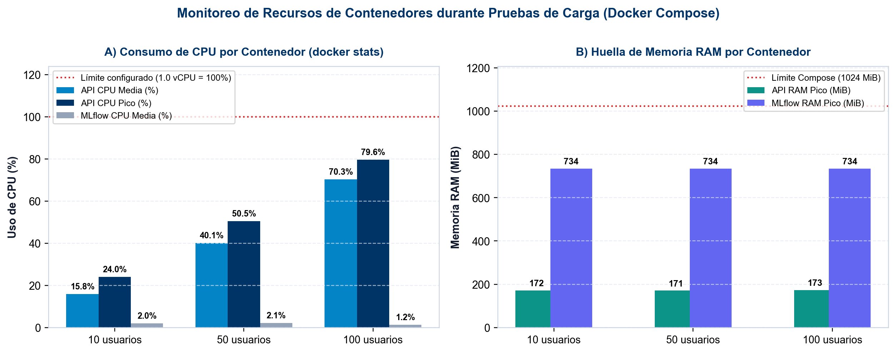
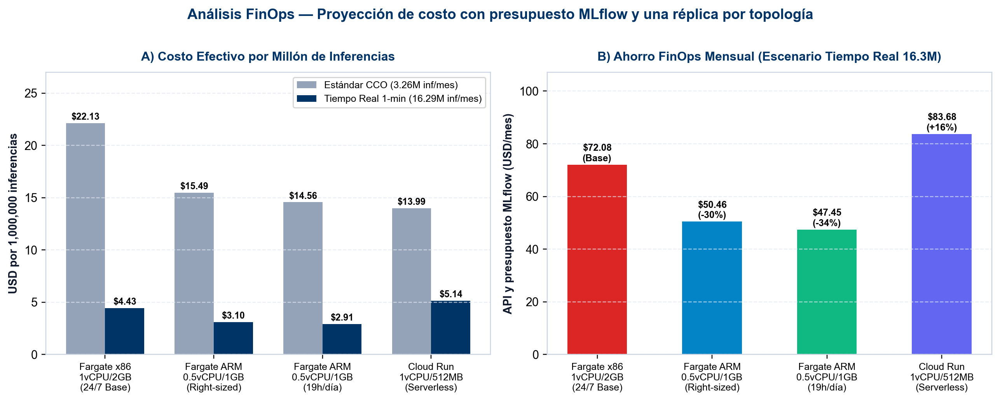

# Operación y análisis FinOps para la plataforma MiBici

Equipo 30 · TC5061 · 22 de noviembre de 2026

## 1 Orquestación y automatización

La plataforma MiBici integra la API de riesgo de P2 con MLflow mediante Docker Compose. Las evidencias del 22 de noviembre de 2026 muestran operación sin errores HTTP en los ensayos de carga. El costo unitario se estima con supuestos explícitos; su validación en cada topología de nube sigue pendiente.

docker-compose.yml define api y mlflow en la red mibici_net, con el volumen mlflow_data para SQLite y artefactos. Ambos servicios tienen healthcheck y límites configurables de CPU y memoria. La API espera a que MLflow esté saludable, carga el modelo al iniciar y publica sus endpoints en localhost.

Un volumen nuevo requiere preparar y registrar el modelo real de P2. Primero se inicia MLflow, se configura MLFLOW_TRACKING_URI y se ejecutan p2_train y p2_register con el run seleccionado. El modelo sintético seed_ci_model.py se reserva para comprobar infraestructura y se identifica como tal.

```bash
docker compose up -d --build mlflow
# Registrar el modelo real según README antes de continuar
docker compose up -d --build
docker compose ps
```

La verificación de Compose conserva 10/10 comprobaciones aprobadas de contrato HTTP y contenedor. El arranque habitual utiliza un solo comando una vez que el volumen contiene el modelo. Cambiar el alias requiere reiniciar la API para cargar la nueva versión.

## Integración y publicación continuas

GitHub Actions ejecuta las suites de API y operación y las de pipelines y validación en Python 3.12. Después construye la imagen con caché de capas, valida Compose, registra un modelo sintético para la prueba de integración y comprueba los endpoints con Locust. En push a main publica la imagen en GHCR.

La corrida histórica #9 terminó en verde en main sobre el commit 8b4e49f e incluyó publicación en GHCR. Publicar una imagen acredita entrega al registro; el repositorio no automatiza su despliegue en un entorno de nube. La revisión actual incorpora regresiones de errores, costos e identidad del modelo; su resultado local se conserva por separado.

Evidencia CI histórica: https://github.com/Diegob059/TC5061-Proyecto-Equipo30/actions/runs/45089840741

Fuentes: docker-compose.yml; .github/workflows/ci-cd.yml; reports/semana10/compose_verification.json. La prueba de CI utiliza un modelo sintético y no acredita el desempeño del modelo de producción.

## 2 Resultados de carga y recursos

Locust combinó POST /predict, GET /health y GET /model-info con ponderación 10:1:1 y pausas de 0.1 a 0.5 s. Los tres ensayos suman 21,342 peticiones, de las cuales 17,853 son predicciones; se registraron cero fallos. Los payloads son escenarios sintéticos de operación.

| Usuarios | Duración | Peticiones | Pred/s | p50 / p95 ms | CPU pico % | RAM MiB |
| --- | --- | --- | --- | --- | --- | --- |
| 10 | 30s | 914 | 26.35 | 7 / 17 | 24.0 | 171.6 |
| 50 | 45s | 6,873 | 131.28 | 5 / 17 | 50.5 | 170.9 |
| 100 | 45s | 13,555 | 256.44 | 9 / 42 | 79.6 | 173.1 |


Figura 1. Throughput total y de predicción y percentiles de POST /predict.

Con 100 usuarios se observaron 307.51 peticiones/s totales y 256.44 predicciones/s, p95 de 42 ms y p99 de 73 ms. Se reporta el throughput del ensayo; la duración y las pausas del generador no permiten establecer la capacidad máxima ni atribuir un cuello de botella a CPU.


Figura 2. CPU y memoria medidas durante los tres ensayos de carga.

La API alcanzó 173.1 MiB y 79.6% de CPU; MLflow, 734.5 MiB. Se guardaron 10, 15 y 15 muestras por contenedor, aproximadamente cada 3 s. La estabilidad observada en ensayos de 30-45 s no acredita ausencia de fugas a largo plazo. Fuentes: load_test_summary.json, docker_stats.csv y locust_*_stats.csv.

## 3 Costo por inferencia

Se modelan 470 estaciones, 19 h/día y 30.4 días/mes. Consultar cada 5 minutos produce 3,257,664 inferencias/mes; cada minuto, 16,288,320. Estas frecuencias y la ventana de operación son supuestos de demanda. La estimación asume una réplica por topología, pendiente de validar con carga en cada configuración.

Para servicios permanentes, costo API = tarifa horaria × horas activas. Costo de cómputo del sistema = costo API + presupuesto MLflow. Costo por inferencia = costo del sistema / inferencias mensuales. AWS Fargate x86 usa 0.04048 USD/vCPU-h y 0.004445 USD/GiB-h; ARM usa 0.03238 y 0.00356, respectivamente [1].

El presupuesto de MLflow es $36.04/mes, correspondiente al supuesto de otra tarea Fargate x86 de 1 vCPU y 2 GiB durante 730 h. Se suma a todos los escenarios. La tabla usa 16.29 millones de inferencias/mes y distingue el costo de la API del cómputo conjunto.

| Topología de la API | API USD/mes | Con MLflow USD/mes | USD/1M con MLflow |
| --- | --- | --- | --- |
| Fargate x86 1 CPU 2 GiB 24 h | $36.04 | $72.08 | $4.43 |
| Fargate ARM 0.5 CPU 1 GiB 24 h | $14.42 | $50.46 | $3.10 |
| Fargate ARM 0.5 CPU 1 GiB 19 h | $11.41 | $47.45 | $2.91 |
| Cloud Run 1 CPU 0.5 GiB serial | $47.64 | $83.68 | $5.14 |


Figura 3. Proyección de cómputo con el mismo presupuesto MLflow en cada topología.

La API ARM programada pasa de $36.04 a $11.41/mes: ahorro estimado de 68.3% en la API y 34.2% en el cómputo conjunto. No se ha medido el desempeño con 0.5 vCPU ARM. Al extrapolar 256.44 pred/s a 730 h se obtienen 673,924,320 inferencias; esta cifra no demuestra capacidad mensual sostenible.

Alcance: cómputo de API y presupuesto MLflow. Se excluyen almacenamiento persistente, transferencia, IPv4, balanceador, logs, entrenamiento e impuestos; el costo total de propiedad será mayor. Tarifas de referencia consultadas el 22 de noviembre de 2026. EC2 Savings Plans se omite por falta de cotización verificable.

## 4 Interpretación y mejoras verificables

Cloud Run se calcula como un escenario sin solicitudes solapadas y con redondeo a 100 ms por periodo aislado, sin nivel gratuito ni arranques en frío. Para 1 vCPU y 0.5 GiB: costo por petición = 0.1 × (0.000024 + 0.5 × 0.0000025) + 0.40/1,000,000 [2]. El escenario cuesta $47.64/mes para la API a 16.29M y $9.53 a 3.26M. La concurrencia real puede cambiar el costo; el ahorro previo de 93% no queda sustentado por esta corrección.

La memoria observada motiva evaluar una asignación menor. Reducir CPU, migrar a ARM, apagar fuera de la ventana prevista o procesar estaciones en lotes son propuestas que requieren benchmark. No se atribuye un ahorro de CPU mayor a 70% al procesamiento por lotes porque ese endpoint no fue implementado ni medido.

## Calidad de la ejecución y trazabilidad

El ejecutor corregido conserva los fallos de Locust y de docker stats, devuelve error cuando la corrida falla y representa mediciones ausentes con null. Lee salidas nuevas de cada ejecución para impedir que un CSV anterior aparente una prueba exitosa. La API resuelve champion a una versión fija al arrancar y expone versión, run_id, origen y fecha de carga.

La evidencia histórica registra champion sin versión exacta ni run_id. Se conserva como medición histórica con procedencia incompleta; no se le asigna retrospectivamente una identidad. Las nuevas corridas guardan la identidad al inicio y al final y rechazan modelos sintéticos, salvo habilitación explícita para evaluar infraestructura.

Validación de esta revisión: 43 pruebas locales aprobadas de API, verificador, operación y regresiones; JUnit en reports/semana10/revision_pytest.xml. No se repitió el ensayo de carga ni se certifica la publicación de esta rama mediante el CI histórico.

## Trabajo del equipo y referencias

La implementación original de operación y sus ajustes se integraron en las PR #50, #51 y #52. Esta revisión añade las correcciones de QA y FinOps y el formato institucional del equipo. Las revisiones entre compañeros deben quedar documentadas en GitHub; no se atribuyen aprobaciones no registradas.

[1] AWS. AWS Fargate Pricing. https://aws.amazon.com/fargate/pricing/
[2] Google Cloud. Cloud Run pricing. https://cloud.google.com/run/pricing
Consulta: 22 de noviembre de 2026. Código base y evidencia histórica: commit 8b4e49f del repositorio del Equipo 30. Fuentes locales: reports/semana10/finops_summary.json y CSV de carga; scripts/finops_analysis.py y run_load_and_monitor.py; api/model_loader.py.
