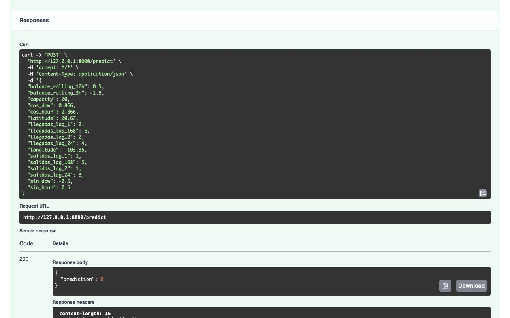

# API REST y contenedores para MiBici

Tecnológico de Monterrey. TC5061. Equipo 30. Verificación del 9 de noviembre de 2026.

## 1 API y modelo registrado

El proyecto MiBici expone el clasificador de riesgo de P2 mediante FastAPI. El endpoint recibe las 17 variables predictoras de una estación y devuelve una clase en JSON. La ejecución documentada verificó el servicio dentro de Podman y la recuperación del modelo desde MLflow Model Registry.

Para esta verificación se reconstruyó localmente LightGBM con la configuración lgbm_profundo y 4,037,300 filas reales de Train, anteriores al corte 2025-12-31 22:00:00. La versión 1 se registró como mibici-equipo30-p2-riesgo con alias champion. Esta reconstrucción tiene su propio run; las métricas y artefactos históricos del equipo se conservan por separado.

| Identificador | Valor verificado |
|---|---|
| Model URI | models:/mibici-equipo30-p2-riesgo@champion |
| Run de validación | 6f794e488be34e3aa862c8b10d04d058 |
| Datos procesados SHA256 | ec233a6298aedeaa6f79b6cbddae846393b56d74327ee673b708aa5f6d276bd4 |

| Método | Endpoint | Función |
|---|---|---|
| GET | / | Estado básico y nombre del modelo |
| GET | /health | Disponibilidad del servicio |
| GET | /model-info | Configuración de carga del modelo |
| POST | /predict | Clasificación de riesgo en JSON |
| GET | /docs | Contrato OpenAPI y pruebas desde Swagger |

capacity debe representar un entero positivo compatible con int32. Las demás variables se validan como valores finitos compatibles con float32, con límites para coordenadas, lags y codificaciones cíclicas. Se rechazan campos extra, faltantes y valores que perderían validez al convertir sus tipos. Las entradas inválidas devuelven HTTP 422 antes de invocar el modelo.

## 2 Contenerización y estrategia de despliegue

Containerfile y Dockerfile utilizan Python 3.12 slim, libgomp1 y las versiones de requirements-api.txt. SQLAlchemy se fija a 2.0.44, compatible con MLflow 3.5.0 y con el entorno principal del proyecto. La construcción con Podman utiliza --format=docker para conservar HEALTHCHECK, que consulta /health cada 30 segundos.

Los siguientes comandos construyen y ejecutan el servicio con Podman. MLflow debe tener disponible el modelo registrado y servir sus artefactos por HTTP.

```bash
make mlflow MLFLOW_PORT=5001
# En otra terminal con el entorno del proyecto activo
make build_container CONTAINER_ENGINE=podman
make run_container CONTAINER_ENGINE=podman MLFLOW_PORT=5001
make test_api_live CONTAINER_ENGINE=podman
```

MLFLOW_PORT configura tanto el servidor como la dirección usada por el contenedor. Podman utiliza host.containers.internal; Docker utiliza host.docker.internal y el mapeo host-gateway en Linux. MODEL_URI permite elegir un alias o una versión.

| Medida | Evidencia de la ejecución |
|---|---|
| Motor | podman version 5.8.9 |
| Imagen | localhost/mibici-risk-api:semana8 |
| Tamaño local de la imagen | 918.6 MiB |
| Contenedor | 514ff295be7ebfbd |
| Estado observado | running con puerto 8000 publicado |

P2 usa inferencia bajo demanda por HTTP porque el cliente puede solicitar una evaluación de riesgo por estación. P1 y P3 conservan sus comandos por lotes. El repositorio no configura una ejecución automática a una hora fija.

El modelo se carga una sola vez al iniciar la API. Si cambia el alias champion, se reinicia el contenedor para cargar la nueva versión. No hace falta reconstruir la imagen mientras el contrato y las dependencias sigan siendo compatibles. Esta implementación no incluye recarga automática del modelo.

## 3 Petición y verificación del servicio

La petición de prueba se envió a POST /predict con los siguientes datos:

```json
{
  "capacity": 20,
  "latitude": 20.67,
  "longitude": -103.35,
  "salidas_lag_1": 1.0,
  "llegadas_lag_1": 2.0,
  "salidas_lag_2": 1.0,
  "llegadas_lag_2": 2.0,
  "salidas_lag_24": 3.0,
  "llegadas_lag_24": 4.0,
  "salidas_lag_168": 5.0,
  "llegadas_lag_168": 6.0,
  "balance_rolling_3h": -1.5,
  "balance_rolling_12h": 0.5,
  "sin_hour": 0.5,
  "cos_hour": 0.866,
  "sin_dow": -0.5,
  "cos_dow": 0.866
}
```

Respuesta observada con el modelo registrado:

```json
{"prediction": 0}
```

La latencia de esa petición fue 4.412 ms. Es una observación local de una petición, no un promedio de carga ni una garantía de latencia en producción. Las clases son 0 normal, 1 riesgo de desabasto y 2 riesgo de saturación, conforme al target de P2.

| Verificación | Resultado observado |
|---|---|
| PyTest del proyecto | 75 aprobadas y 0 omitidas |
| HTTP del servicio en contenedor | 10 de 10 comprobaciones aprobadas |
| Auditor contra simulación válida | PASS 10 de 10 y código de salida 0 |
| Auditor contra respuestas 503 | FAIL 0 de 10 y código de salida 1 esperado |

El auditor valida códigos HTTP y contenido JSON. También exige un contenedor activo cuyo puerto publicado coincida con el servicio comprobado. Conserva errores de conexión y validación en JSON y devuelve un código distinto de cero ante fallos. Las simulaciones prueban el comportamiento del auditor y se distinguen de la ejecución con MLflow y el modelo reales.

## 4 Evidencia y contribuciones del equipo

La siguiente captura muestra la API respondiendo desde el servicio contenerizado. Su procedencia y hash se conservan en reports/semana8/capture_provenance.json. El contenedor y su puerto se verificaron mediante la inspección del motor registrada en reports/container_verification.json.



| Integrante | Contribución identificable en Git |
|---|---|
| Freddin Alcántara | PR 32 con la API base y carga desde MLflow |
| Diego Becerril | PR 33 con validación de entradas y definición de contenedor |
| Ricardo Bahamón | PR 34 a 40 con integración, contenedores, pruebas y documentación |
| Gregorio Escobedo Straffon | Commit b5b9119 con validación de tipos, puertos, auditor y regresiones; evidencia de ejecución y actualización de este reporte |

El servicio respondió a la petición válida y rechazó las entradas inválidas del conjunto de verificación. Los registros conservan los resultados, la procedencia del modelo y los hashes del código probado. Esta evidencia respalda la ejecución local documentada con el modelo y la imagen identificados.

Fuentes de evidencia: reports/semana8/pytest.xml, pytest.log, registry_validation.json, container-build.log y execution.json; reports/container_verification.json.

Referencias técnicas: FastAPI, FastAPI in Containers, https://fastapi.tiangolo.com/deployment/docker/ ; MLflow, Deploy MLflow Model as a Local Inference Server, https://mlflow.org/docs/latest/ml/deployment/deploy-model-locally/ ; Podman, Installation, https://podman.io/docs/installation .
