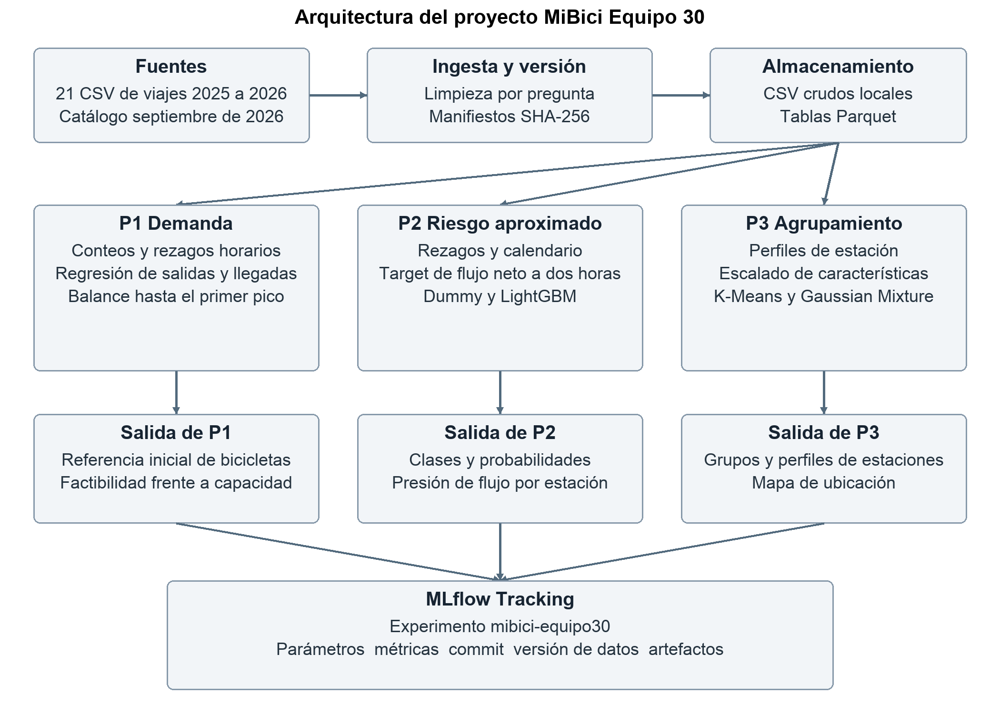
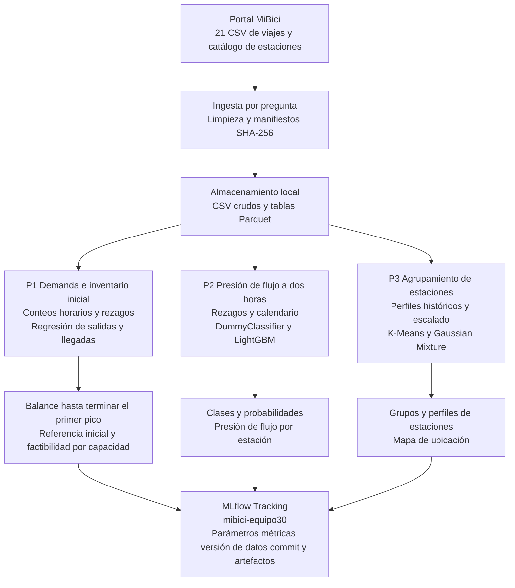

# Arquitectura general del proyecto MiBici

El diagrama conecta las tres preguntas del equipo con la ingesta, el almacenamiento y el registro de experimentos. Los experimentos usan viajes de enero de 2025 a septiembre de 2026 y el catálogo de septiembre de 2026.

## Diagrama editable

## Herramientas y módulos

- **Ingesta y almacenamiento:** pandas prepara los datos por pregunta; Parquet guarda las tablas intermedias y procesadas. Los manifiestos relacionan los resultados con hashes SHA-256 de sus archivos.
- **P1:** `src/data/p1_dataset.py`, `src/features/p1_features.py` y `src/models/p1_*.py` comparan repetición semanal, promedio histórico y árboles de regresión. El balance utiliza las salidas y llegadas previstas; después revisa capacidad y espacio para devoluciones.
- **P2:** `src/data/p2_dataset.py`, `src/features/p2_features.py` y `src/models/p2_train.py` preparan el indicador de flujo futuro y comparan un clasificador estratificado con LightGBM.
- **P3:** `src/data/dataset.py`, `src/features/features.py` y `src/models/p3_train.py` preparan perfiles de estaciones y comparan K-Means con Gaussian Mixture mediante scikit-learn.
- **Experimentos:** `src/models/run_all_experiments.py` ejecuta los modelos con sus datos previamente preparados. MLflow registra parámetros, métricas, etiquetas y artefactos; Git identifica el código usado.

## Alcance de los resultados

P1 genera una referencia de inventario inicial a partir de movimientos previstos. P2 aproxima presión de flujo y no observa inventario físico. P3 describe grupos en la historia analizada. Los resultados corresponden a experimentos retrospectivos; no acreditan una operación desplegada.

La evaluación actual de P2 conserva dos horas de entrenamiento cuyo horizonte cruza al periodo de prueba. Corregirla requiere excluir esas filas y volver a generar las métricas y evidencias. En P3, el registro actual comparte las figuras y el reporte del candidato con el baseline; esos artefactos deben separarse.

El [Canvas completo](ml_canvas_equipo30.docx) y la [propuesta](../docs/TC5061_Propuesta_Proyecto_Equipo30.pdf) detallan las decisiones, los supuestos y las herramientas. El [diagrama específico de P2](p2_architecture_diagram.md) conserva el diseño previo de esa pregunta y debe interpretarse con las limitaciones anteriores.
